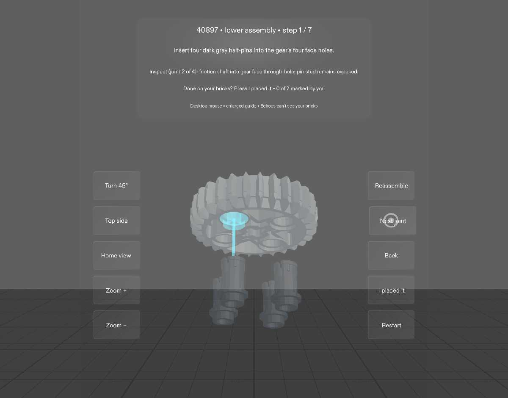
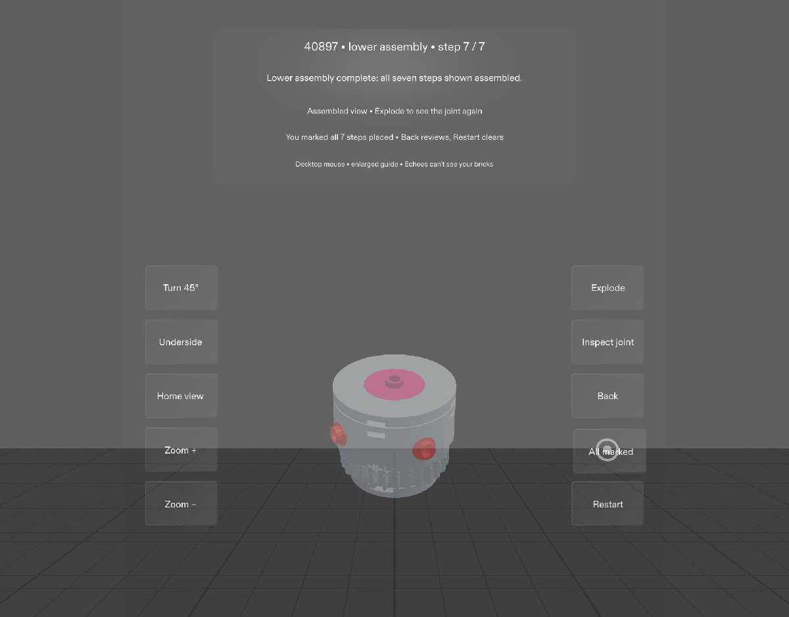

# Echoes: guidance beside the work

Echoes explores how SPECS could help with everyday tasks. This working example is a seven-step spatial brick-building guide for the lower assembly of LEGO 40897. It demonstrates how an inspectable model can explain where a piece goes while keeping the current step and progress close to the task.

**Current demonstration:** an enlarged virtual guide in Lens Studio's desktop Preview. The broader everyday-task concept is the goal; other task modules and physical perception are not implemented.

## What works

- **See the next connection.** Incoming pieces are separated from the assembly, with cyan final-position ghosts and insertion paths.
- **Look from a useful angle.** Turn 45°, drag to orbit, switch between top and underside, adjust zoom, or return Home.
- **Inspect every joint.** Inspect joint moves through the step's incoming parts; Return restores the previous view. There are 17 incoming pieces across seven steps.
- **Review without losing your place.** “I placed it” records your own confirmation and advances. Back preserves your marks; Restart clears them. “All marked” is the finished-state label, not an extra action.

## Actual Preview captures

These are real Lens Studio Preview captures collected during automated/injected validation, not concept images or evidence of physical recognition.

Step 1, inspecting the second of four pin joints:

After all seven steps have been manually marked:

## Run it

1. Use **Lens Studio 5.23.2**. This ZIP contains materialized assets; extract it and open `Echoes.esproj`. If later obtaining a Git checkout, use Git LFS to materialize assets.
2. Keep **Echoes 40897 Guide** enabled and **Echoes Signal Arch** disabled in the scene.
3. In Preview, select the third input icon (Interactive), choose **Plane**, and use **SPECS 27**. Refresh Preview to start at step 1 with zero marks.
4. Click the large controls to operate them; drag in the center to orbit. At each step, Inspect the joints, Return, then click **I placed it**.

See the [setup and rehearsal instructions](devpost/run-instructions.md). No SPECS headset is required for desktop Preview.

## What the evidence establishes

- Guide-specific LEAF suites: **24/24** control checks and **79/79** step-flow checks, including all 17 incoming joints.
- Source checks: **29/29**; seeded state stress: **50,000 actions, zero failures**.
- A fresh local clone compiled, started and passed the guide suites. This is local reproducibility evidence, not a public-download test.
- A **2:14.2 local demo** is available with injected-input labeling on every frame. It is not a recording of the later human mouse pass.

See the [technical evidence summary](validation/guide-hero/evidence-summary.md) for tests and coverage limits. Earlier Signal Arch test counts do not establish this guide's behavior.

## Limits

Echoes cannot see or verify physical bricks. “I placed it” is the user's statement. Physical fit, device comfort and real hand tracking are unverified. There is no live camera overlay, physical recognition or AI operator. The guide itself makes no network requests. Progress is not a claim of persistent memory across sessions.

## Approved design direction

The [Echoes design brief](devpost/design-brief.md) separates the working desktop guide from future hands-free, peripheral-placement and focus-activation experiments. Its approval covers design framing, not publication or device validation.

## Credits and project contents

Geometry derives from the **LDraw parts library, CC BY 4.0**, with triangulation and quantization changes. See the [human-readable credits](devpost/guide-credits.md) and [per-file attribution](devpost/ldraw-attribution.json). Incorporated Snap packages retain their own terms; see the [asset record](devpost/asset-record.md).

The current module covers seven steps and 17 incoming parts. The earlier Signal Arch module remains disabled in the scene. Its assets and test registrations are retained to preserve project dependencies; its test counts are not evidence for this guide. Historical development reports, conversations and planning drafts are not included in this export.
