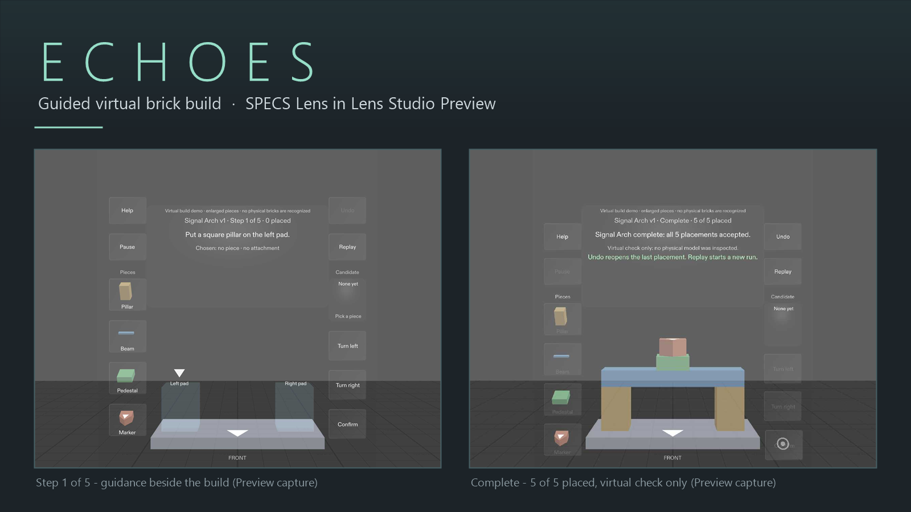
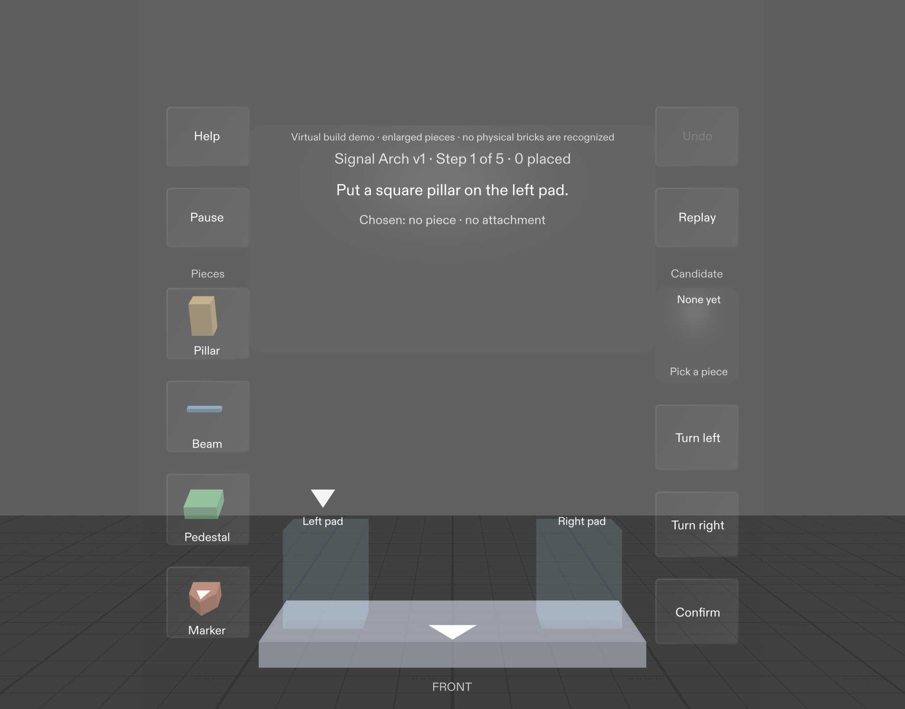
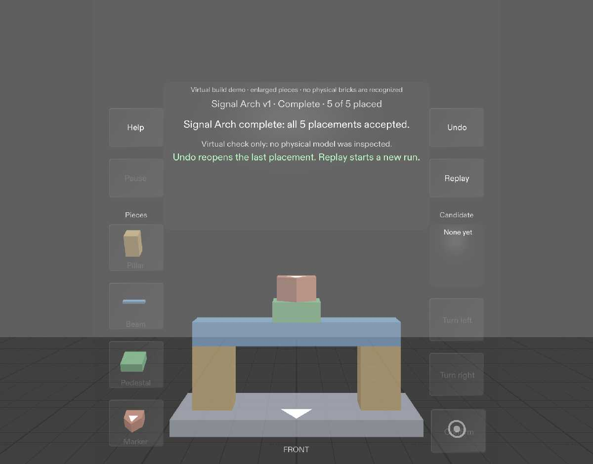

# Echoes

*Hero image built from two real Lens Studio Preview captures. It is not an AI or concept illustration. Both captures appear at full size under [Screenshots](#screenshots).*

Echoes is a companion that stays beside your work. In this demo it guides you through assembling the **Signal Arch**, an original five-piece virtual brick model, in a SPECS Lens. Each instruction appears where the work happens.

- **Guided next action.** The current step, a pointer, and a prompt for the staged candidate ("Press Confirm to place") sit beside the build.
- **Specific correction, zero loss.** If the piece, attachment, or orientation is wrong, Echoes names the actual mismatch, checking target, then piece, then orientation. It never touches accepted work.
- **Interruption-safe.** Help never advances the task. Pause/Resume restores the exact state. Undo removes only the latest placement, even after completion. Replay resets cleanly and drops stale callbacks.
- **Truthful completion.** The build finishes only when all five placements and the visible assembly agree: "Virtual check only: no physical model was inspected."

## What it is not

The Lens says so on screen: "Virtual build demo · enlarged pieces · no physical bricks are recognized." It has no camera perception, no physical verification, and no AI model in the loop. It is a deterministic authored task that makes no network calls. It was built and tested entirely in Lens Studio Preview. Device comfort and hand tracking are untested because no SPECS device was available.

## Screenshots

Step 1 of 5: the guidance card, piece tray, and controls beside the base plate. Front view at 90 cm, Lens Studio Preview.

Completion: 5 of 5 placed, with the "Virtual check only" statement.

## Run it

See [devpost/run-instructions.md](devpost/run-instructions.md). You need Lens Studio 5.23.2 and Git LFS.

## How it was verified

- 8 LEAF scenario suites: 220 checks, 0 failures, covering every done criterion
- A 41-assertion in-lens state suite
- A clean-clone rehearsal and a remote clone-from-GitHub rehearsal, each running the full story
- Nine human Preview sessions by a first-time operator, plus comprehension testing with uncoached viewers (a 2-viewer sample, honestly recorded)

The full evidence trail is in [devpost/echoes-acceptance-matrix.md](devpost/echoes-acceptance-matrix.md).

## How it was built

Echoes was built in Lens Studio 5.23.2 (SPECS Base Template) with Claude Opus 5.5 as the coding agent through CLAD. It uses Spectacles Interaction Kit, UI Kit, and LEAF 2.0.2, all disclosed in [devpost/asset-record.md](devpost/asset-record.md). Scope is governed by the approved [devpost/design-brief.md](devpost/design-brief.md).

## License / rights

The authored content is original. Incorporated packages are disclosed in [devpost/asset-record.md](devpost/asset-record.md).
